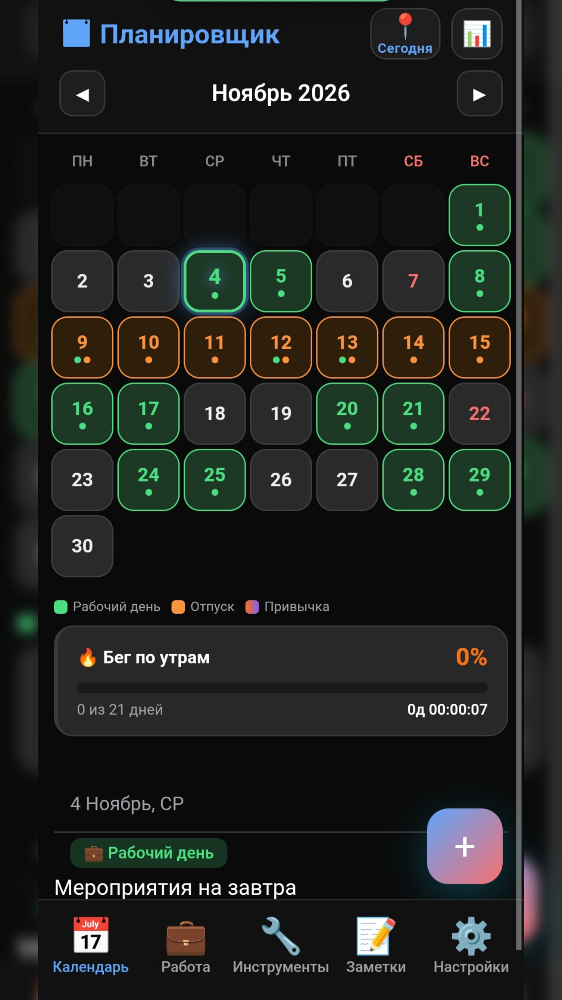
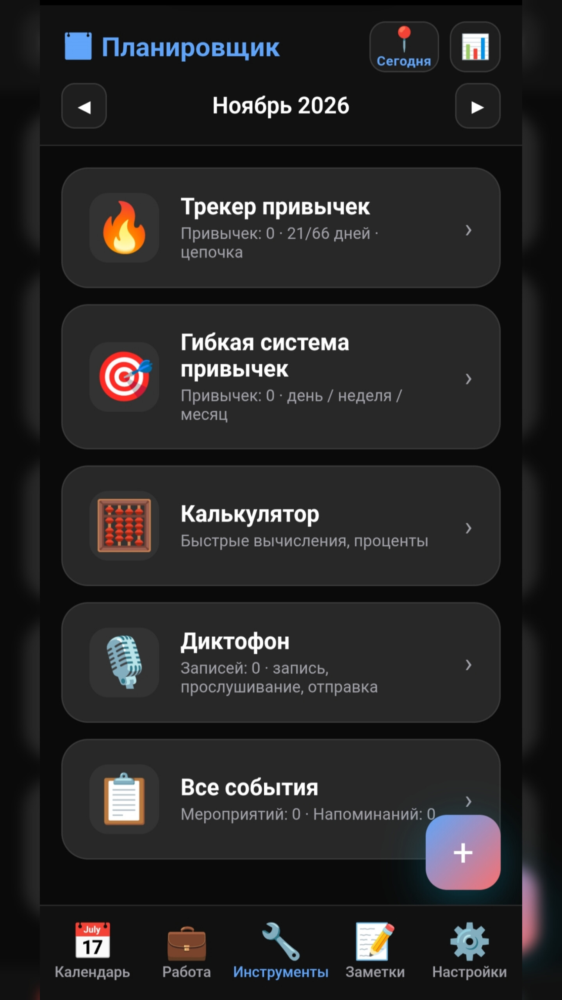
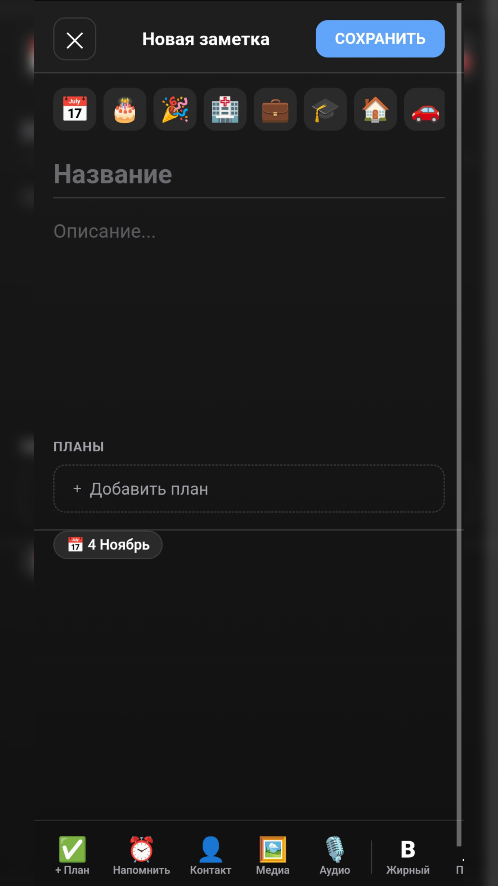
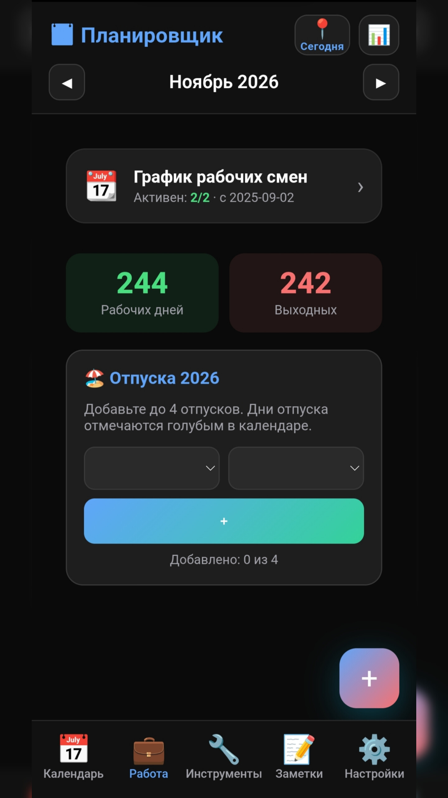
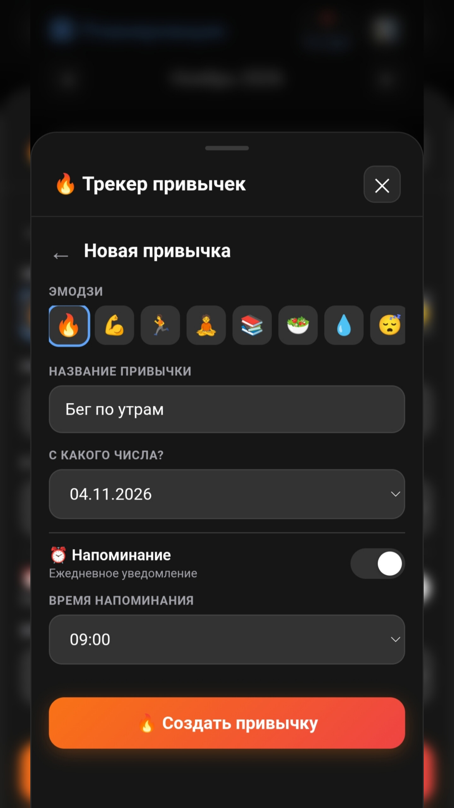

# 📅 PlannerLife

**PlannerLife** — мощный органайзер для продуктивной жизни. Календарь, заметки, аудио-записи, трекер привычек и калькулятор в одном приложении.
*(Powerful organizer for productive life. Calendar, notes, audio recordings, habit tracker, and calculator in one app.)*

## 🎞️ История создания / The Story Behind

🇷🇺 Мне всегда не хватало одного приложения, где можно было бы вести календарь, записывать голосовые заметки на ходу, отслеживать привычки и быстро что-то посчитать — без переключения между пятью разными программами. Так появился PlannerLife.

Основные возможности:

📅 Умный календарь и график работы

Планируйте мероприятия и встречи.

Настраивайте индивидуальный график работы (смены, цикличность).

Отмечайте отпускные дни и выходные, чтобы всегда видеть свободное время.

✅ Трекеры привычек (2 режима)

Два вида трекеров для отслеживания ваших ежедневных ритуалов и целей.

Формируйте полезные привычки и следите за прогрессом.

📝 Многофункциональные заметки

Создавайте списки дел и планы действий.

Добавляйте контакты прямо в заметку.

Прикрепляйте фото и записывайте аудиозаметки на ходу.

⏰ Напоминания и события

Создавайте напоминания о важных делах.

Планируйте масштабные мероприятия.

🎙️ Встроенные инструменты

Диктофон: Записывайте идеи или лекции, не выходя из приложения.

Калькулятор: Быстрые вычисления прямо в планировщике.

Почему PlannerLife?

Всё в одном: Не переключайтесь между приложениями.

Гибкость: Настройте график под свою жизнь.

Удобство: Интуитивно понятный интерфейс.

## 🖼️ Скриншоты / Screenshots

<table>
<tr>
<td></td>
<td></td>
<td></td>
<td></td>
<td></td>
</tr>
</table>

## 📥 Скачать / Download

### APK (Android)
📥 **[Скачать последнюю версию (v1.0.0)](https://github.com/Paminabea/plannerlife-app/releases/download/v1.0.0/PlannerLife.apk)**

### Магазины приложений / App Stores
- [RuStore]() 
- [Huawei AppGallery]() 

## 🛠️ Технологии / Tech Stack
HTML5 Canvas • JavaScript • CSS3 • Capacitor/Cordova (для сборки APK)

## 👨‍💻 Автор / Author
**Сергей (Paminabea)**  
GitHub: [@Paminabea](https://github.com/Paminabea) | Email: paminabea@gmail.com

## 📄 Лицензия / License
MIT License — см. файл [LICENSE](LICENSE)
